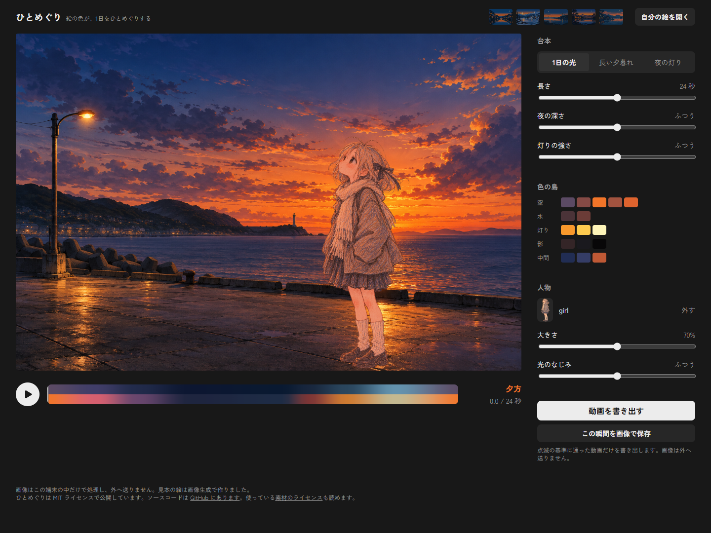
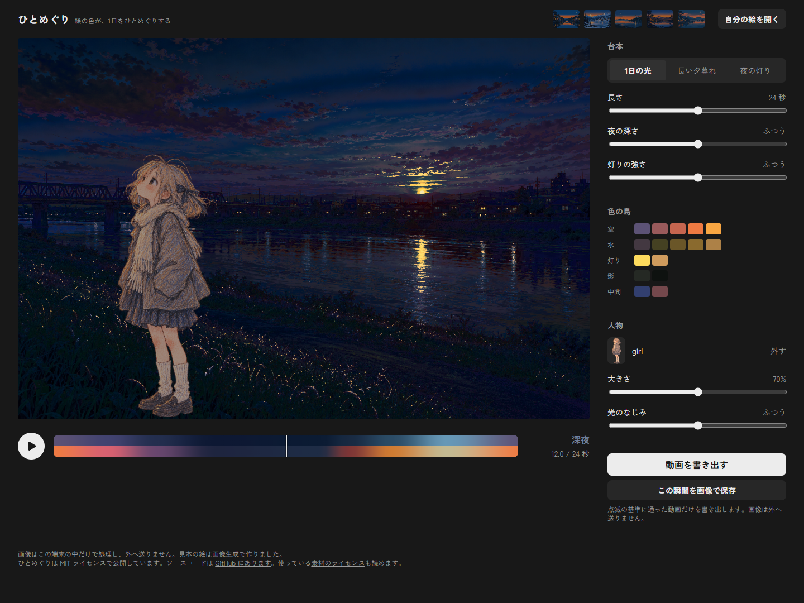
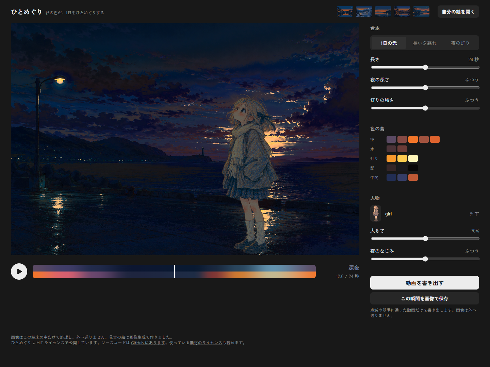
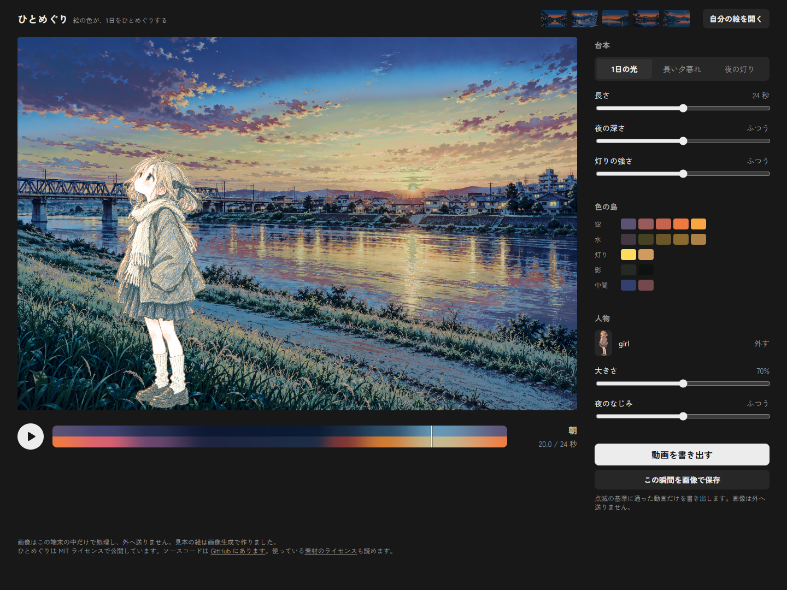

# V02 人物の重ねの実装と検査

受け手は、試作の受け入れを行うメイン。ADR-0009 と `docs/design/foreground.md` の機械的な基準、実素材の見た目、再検査の入口をまとめる。採用と main への合流はメインと利用者が判断する。

## v2 の式

2026-10-27。正本は `surumenDD/main` の `b6e3f17` にある設計文書と ADR-0009。素材 `544aca9`、経過 `8189ff5`、設計 v2 `b6e3f17` をこの枝へ cherry-pick した（枝では順に `6539183`、`70a9387`、`aab77c9`）。docs と assets の独自編集はない。main への合流と push は行っていない。

上空と地平の OKLab 平均 `S(t)` から、CPU でコマごとに `E = clamp(S_L / 0.7, 0.3, 1.15)` と光の色 `C` を求める。`C` は OKLab `(0.85, 1.3 × S_a, 1.3 × S_b)` を線形 sRGB に直し、負の成分を 0.0001 に置き換え、最大成分で割った値。空の島がなければ `E=1, C=(1,1,1)` にする。

シェーダーへ露出と色を uniform で渡し、人物の線形 sRGB に `clamp(fg × (1 + f × (E × C − 1)), 0, 1)` を当て、ストレートの透明度で背景と線形合成する。人物のテクスチャは従来の OKLab と透明度のまま保持し、式の前に線形 sRGB へ戻す。v1 の L の比、彩度の係数、色ずらし、0.35×L の下限は削除した。通常の人物の値は式で色域内に収まり、島選択・分割のプレビューだけは OKLab に戻して L×0.6・彩度×0.25 と既存の gamutMap を当てる。保存にはプレビューの沈めを入れない。

目盛りは「光のなじみ」、出力欄は「なし・弱め・ふつう・強め・最大」。標準 0.8、左半分 0→0.8／右半分 0.8→1 の折れ線、道具の引数 `blend` は維持した。

### v2 の基準ごとの結果

| 領域                     | 結果 | 根拠                                                                                                                                                                                                            |
| ------------------------ | ---- | --------------------------------------------------------------------------------------------------------------------------------------------------------------------------------------------------------------- |
| 元に戻る・背景           | 合格 | 合成素材と実素材2場面×3台本×始まり/終わりの18描画で、元画像の全画素と差0。Workerへ転送する前の元画像を比較用に残して検査する。                                                                                  |
| 元に戻る・人物つき       | 合格 | 同じ18描画がCPUの「元の背景＋光を受けた人物の線形合成」と最大差1以内。3場面×3台本の始まりと終わりの9比較は全画素で差0。開始時刻から光を受けることもVitestで検査。                                               |
| なじみ0                  | 合格 | Vitestで3台本×5時点の線形素材を検査。実シェーダーは3場面×3台本×3時点×なじみ0/0.8/1の81比較でCPUの式と最大差1以内（海辺は差0）。                                                                                 |
| 露出・光の色・線形の範囲 | 合格 | 3台本×101時点で E=0.3〜1.15、Cの最大成分1、全成分0〜1かつ有限。黒い元空、負の光成分、空なし、黒と白、露出とfの上下端を検査。人物の線形値は0〜1。人物関係の単体検査19件。                                        |
| 点滅                     | 合格 | 実素材2背景×3台本の6本をv2で再出力。保存前の実描画判定を通過し、保存MP4の全4560コマを復号したflash-checkもWCAG・ITUとも合格。下表参照。                                                                         |
| 人物なし                 | 合格 | f247477の固定シェーダーと3場面×3台本×6時点の54比較で差0。既存8画像の再現と台本の端点もPSNR Infinity。npm run checkに合格。                                                                                      |
| 操作・3ブラウザ・axe     | 合格 | Chrome 155.0.8059.86、Firefox 158.0、WebKit 27.2の重ねる／外す／大きさ／光のなじみ／位置が合格。各8状態のaxe違反0、ページとコンソールのエラー0。位置の白1px点線の焦点、ドラッグ、範囲、背景変更時の保持も合格。 |
| 60fps                    | 合格 | 1920×1080、RTX 5070 Ti／ANGLE D3D11。GPU中央値0.177344ms、同期した壁時計中央値0.500ms、RAF中央値16.7ms、95パーセンタイル16.8ms、最大17.0ms。v1と同じ準備12回・計測31回・RAF120区間。                            |
| PNG・プレビュー          | 合格 | 3場面×夕方/深夜/昼相当の9枚で、PNG復号後と通常描画の差0。島選択で人物を沈め、分割で反対側を沈める検査も合格。                                                                                                   |
| 読み込み・タッチ         | 合格 | 透過の割合とアルファ250の境界、2048px縮小、読み込み中のdisabledを再検査。Chromeの390pxで実際のタッチドラッグと横にはみ出さないことも合格。                                                                      |
| READMEのループの道具     | 合格 | foreground/x/y/size/blendをすべて明示して6本を出力し、@の役割指定も併用。追加の20秒×3本で、人物つきの次の人物なしジョブと、単独の人物なしジョブの復号600コマのハッシュが一致。人物つきのハッシュは異なる。      |

`npm run check` は型・Biome・14ファイル82件のVitest・開発版Chrome・配布版Chrome・174依存のライセンス検査に合格。`npm run test:compat`、`node test/v02-foreground.mjs`、`node test/v02-captures.mjs`、`node test/v02-touch.mjs`、READMEの6本の再出力、`node test/v02-flash.mjs` を再実行した。WebKitはこの環境でH.264のWebCodecsに非対応で、既存の案内とPNGを検査した。

数値と基準別の根拠は [v2の検査結果](V02-v2-results.json)。生の結果と動画は `test/results/v02/`、3ブラウザの詳細は `test/results/m4-browsers/report.json`（いずれもGit管理外）。比較用の [v1の検査結果](V02-results.json) と以下のv1の数値は変更せず残した。画面写真も `V02-v2-*` に分け、v1の写真を残した。

### v2 の保存動画の点滅

960×640、30fps。白200cd/m²、ブロック8px、`--css-px-per-px 1.6`。最大回数は場所ごとの1秒あたりの値で、WCAGとITUの値は同じ。

| 背景 | 台本       | 秒/コマ | WCAG | ITU  | 最大回数/秒 |
| ---- | ---------- | ------- | ---- | ---- | ----------- |
| 海辺 | 1日の光    | 24/720  | 合格 | 合格 | 1           |
| 海辺 | 長い夕暮れ | 20/600  | 合格 | 合格 | 1           |
| 海辺 | 夜の灯り   | 32/960  | 合格 | 合格 | 1           |
| 土手 | 1日の光    | 24/720  | 合格 | 合格 | 1           |
| 土手 | 長い夕暮れ | 20/600  | 合格 | 合格 | 1           |
| 土手 | 夜の灯り   | 32/960  | 合格 | 合格 | 0           |

### v2 の画面写真

配布版、実素材、光のなじみ0.8、大きさ70%。v1と比べるため、海辺x=0.68・y=1、土手x=0.25・y=1を使った。夕方0秒、深夜12秒、昼相当20秒（台本上の表示は「朝」）。6枚すべてを目視し、夕方の暖色、深夜の減光、昼の明るさと人物パネルの表記を確認した。見た目の最終の受け入れと採用はメイン・利用者が判断する。

| 場面 | 人物なし                                 | 夕方                                 | 深夜                                  | 昼相当                             | スマホ                               |
| ---- | ---------------------------------------- | ------------------------------------ | ------------------------------------- | ---------------------------------- | ------------------------------------ |
| 海辺 | [人物なし](V02-v2-seaside-without.png)   | [夕方](V02-v2-seaside-evening.png)   | [深夜](V02-v2-seaside-midnight.png)   | [昼相当](V02-v2-seaside-day.png)   | [390px](V02-v2-seaside-mobile.png)   |
| 土手 | [人物なし](V02-v2-riverbank-without.png) | [夕方](V02-v2-riverbank-evening.png) | [深夜](V02-v2-riverbank-midnight.png) | [昼相当](V02-v2-riverbank-day.png) | [390px](V02-v2-riverbank-mobile.png) |





パネルの [人物なし](V02-v2-chrome-empty.png)、[読み込み中](V02-v2-chrome-loading.png)、[透過なし](V02-v2-chrome-opaque.png)、[人物あり](V02-v2-chrome-present.png)、[位置の焦点](V02-v2-chrome-position-focus.png)、[外した後](V02-v2-chrome-removed.png) もv2で再撮影。同じ状態のFirefox・WebKitは `V02-v2-firefox-*`・`V02-v2-webkit-*`。[タッチ](V02-v2-touch-mobile.png)、[島選択](V02-v2-production-island.png)、[分割](V02-v2-production-split.png) も保存した。

## v1 の記録

以下は初回の試作の結果。式の数値、検査結果、写真を比較用にそのまま残す。

## v1 — 実装の条件

- 枝: `surumenDD/v02-foreground`。出発点は `f247477`。main への合流と push は行っていない。
- 実装と検査のコミットは `3f299db`。画面写真とこの報告は別のコミットにまとめる。
- メインが渡した素材 `6125316`、位置の範囲等の回答 `c9246e5`、基準色の平均と標準0.8への変更 `7f78711`、昼の倍率の訂正 `ce4dd68` を取り込んだ。docs と assets は、メインのコミットの取り込みだけで、独自に変更していない。
- 最終の基準色は、帯の上空と地平の **OKLab の平均**。標準の夜のなじみは **0.8**。式の係数と下限は設計どおり。標準の明るさの上限は1.20倍、なじみ1では1.25倍（L自体は1で止める）。
- `girl.png`、`seaside.png`、`riverbank.png` の実素材に加え、透過の円と胴体を組み合わせた128×192の合成素材を使った。背景の役割は自動の推定。海辺は標準の位置、土手は x=0.25。

## v1 — 受け入れの基準

| 領域                 | 結果 | 根拠                                                                                                                                                                                                                         |
| -------------------- | ---- | ---------------------------------------------------------------------------------------------------------------------------------------------------------------------------------------------------------------------------- |
| 元に戻る             | 合格 | 3素材×3台本×始まり/終わりの18描画をCPUの線形合成と比較。8ビットで最大差1以下。背景と人物の半透明の輪郭も比較に含む。                                                                                                         |
| なじみ0              | 合格 | Vitestで3台本の任意の時刻を検査。実シェーダーも中間時刻でCPUの式と照合する。                                                                                                                                                 |
| 明るさの範囲         | 合格 | VitestでL・k・fの範囲と上下限を検査。最暗条件でも0.35×Lを保ち、白は1で止まる。                                                                                                                                               |
| 点滅                 | 合格 | 実素材の2背景×3台本の6本を、書き出し前の実描画判定と、保存MP4の復号後のflash-checkの両方で検査。WCAG・ITUとも合格。                                                                                                          |
| 人物なし             | 合格 | f247477のシェーダーを固定データとして保存し、3素材の背景×3台本×6時点の54比較で画素差0。既存8画像の再現と3台本の端点もPSNR Infinity。`npm run check` 合格。                                                                   |
| 操作                 | 合格 | Chrome・Firefox・WebKitで重ねる、外す、大きさ、夜のなじみ、位置をキーボードで操作。各8状態のaxe違反0、コンソールとページのエラー0。マウスのドラッグと範囲も検査。Chromeの390px画面では実際のタッチ入力によるドラッグも合格。 |
| READMEのループの道具 | 合格 | 人物のパスとx/y/size/blendを渡して6本のMP4を出力。既存の@の役割指定と両立し、人物なしの次のジョブへ人物を持ち越さない。                                                                                                      |
| PNGとプレビュー      | 合格 | 合成素材・実素材2枚の夕方/深夜/昼相当の9枚を保存し、PNGの復号画素と通常の合成描画の差0。島選択では人物全体を沈め、分割では反対側を沈めることを画素で検査。保存には沈めを入れない。                                           |
| 画像と読み込み       | 合格 | アルファ250未満の画素が1%未満なら拒否、ちょうど1%なら受け付ける。4096×2の人物を2048×1に縮小する検査も合格。人物の読み込み中は操作をdisabledにする。                                                                          |

実シェーダーの中間時刻の照合は、3素材×3台本×3時刻×なじみ0/0.8/1の81比較。人物の透明度が0.9以上の画素について、CPUで背景の色の移動・人物の式・gamutMap・線形合成・sRGBへの変換を求め、最大差1以下を条件にする。実素材の女の子のアルファの最大は254で、完全に不透明な画素は無いため、背景との合成も計算に含める。端点の比較は全画面を対象にする。

## v1 — 描画と保存のつなぎ方

`src/foreground.ts` が人物のOKLabとストレートの透明度を1枚に持つ。Rendererはテクスチャを1枚追加し、既存と同じフラグメントシェーダーの最後で、背景の色を移した後に人物をなじませて線形の光で合成する。描画のパスは増やしていない。人物なしでは元の背景の計算をそのまま通す。

CPUは既に求めた台本のパレットから、上空と地平の平均と元の平均を求める。明るさの比kと、a/bの差分だけをuniformで渡す。空が無ければk=1・差分0、元の平均のLが0ならkだけを1にする。人物は島に分けない。

位置の下端の中心はx=0〜1、y=0.2〜(1+size×0.5)で止める。ドラッグ、タッチ、矢印キーは同じストアの処理を使う。大きさを小さくしてyの上限が変わる場合も収める。背景を替えたときは人物と設定を保つ。

MP4の `checkFrames` とエンコード、PNG、画面のPlayerが同じ人物のデータと式を使う。書き出し中は人物の操作も無効にし、設定を固定する。保存へ島の選択や分割のプレビューを渡さない。

描く前の **estimateには人物の分を足していない**（Taskの指定）。既存の見積もりは、背景の固定重みとパレットの差分、背景のLの包絡を対象にしたものなので、人物の明るさの乗算と色ずらしには同じ式を流用できない。試作ではその範囲を広げず、人物の変更では既存の背景の見積もりを維持し、保存の可否は人物を含む実描画のWCAG・ITU判定で必ず確かめる。人物なしの見積もりと操作の端は変えていない。

## v1 — ブラウザ

| ブラウザ               | 人物と既存の操作 | axe          | MP4                                                                       |
| ---------------------- | ---------------- | ------------ | ------------------------------------------------------------------------- |
| Chrome 155.0.8059.86   | 合格             | 8状態、違反0 | 保存・中止に合格                                                          |
| Firefox 158.0          | 合格             | 8状態、違反0 | 保存・中止に合格                                                          |
| WebKit 27.2（Windows） | 合格             | 8状態、違反0 | WebCodecsのH.264非対応。既存の案内を表示し、PNGが引き続き使えることに合格 |

人物の位置の焦点は設計どおり白い1pxの点線。ほかの操作は既存の2pxの輪。WebKitで有効なWebPのMIME情報がChrome等と異なったため、人物のファイルはPNG/WebPの署名を確認し、共有のデコーダーに正規のMIMEを渡すようにした。透過なしの判定はその後の画素で行う。

## v1 — 保存動画の点滅

960×640、30fps。白200cd/m²、ブロック8px、元画像との比に合わせ `--css-px-per-px 1.6`。最大回数は、場所ごとに数えた1秒あたりの値。

| 背景 | 台本       | 秒/コマ | WCAG | ITU  | 最大回数/秒 |
| ---- | ---------- | ------- | ---- | ---- | ----------- |
| 海辺 | 1日の光    | 24/720  | 合格 | 合格 | 1           |
| 海辺 | 長い夕暮れ | 20/600  | 合格 | 合格 | 1           |
| 海辺 | 夜の灯り   | 32/960  | 合格 | 合格 | 1           |
| 土手 | 1日の光    | 24/720  | 合格 | 合格 | 1           |
| 土手 | 長い夕暮れ | 20/600  | 合格 | 合格 | 1           |
| 土手 | 夜の灯り   | 32/960  | 合格 | 合格 | 0           |

MP4とflash-checkの生の結果は `app/test/results/v02/videos/`（Git管理外）。6本の実コマすべてを復号して検査した。

## v1 — 画面写真

配布版で実素材を開いた写真。夕方は0秒、深夜は12秒、昼相当は20秒（既存の台本の表示は「朝」）。夜のなじみは標準0.8。

| 場面 | 人物なし                              | 夕方                              | 深夜                               | 昼相当                          | スマホ                            |
| ---- | ------------------------------------- | --------------------------------- | ---------------------------------- | ------------------------------- | --------------------------------- |
| 海辺 | [人物なし](V02-seaside-without.png)   | [夕方](V02-seaside-evening.png)   | [深夜](V02-seaside-midnight.png)   | [昼相当](V02-seaside-day.png)   | [390px](V02-seaside-mobile.png)   |
| 土手 | [人物なし](V02-riverbank-without.png) | [夕方](V02-riverbank-evening.png) | [深夜](V02-riverbank-midnight.png) | [昼相当](V02-riverbank-day.png) | [390px](V02-riverbank-mobile.png) |





人物の節の各状態は [なし](V02-chrome-empty.png)、[読み込み中](V02-chrome-loading.png)、[透過なしのエラー](V02-chrome-opaque.png)、[人物あり](V02-chrome-present.png)、[位置の焦点](V02-chrome-position-focus.png)、[外した後](V02-chrome-removed.png)。同じ6状態をFirefox・WebKitでも `V02-firefox-*`・`V02-webkit-*` に保存した。[実際のタッチのドラッグ](V02-touch-mobile.png)、[島の選択](V02-production-island.png)、[分割中](V02-production-split.png) も保存した。

## v1 — 再検査

`app/` で実行する。前提はREADMEの依存とブラウザ、ffmpeg/ffprobe。追加のパッケージはない。

```powershell
npm run check
npm run test:compat
node test/v02-foreground.mjs
node test/v02-captures.mjs
node test/v02-touch.mjs
# README「人物つきの README のループ」の指定で6本を出力
node test/v02-flash.mjs
```

`npm run check` は型検査・Biome・14ファイル81件のVitest・開発版Chrome・配布版Chrome・174依存のライセンス検査に合格。人物の式と透過等の単体検査は18件。三ブラウザの詳細は `test/results/m4-browsers/report.json`、描画の詳細は `test/results/v02/report.json`、実行ログは `test/results/v02/` に置く。テストのサーバーとブラウザは各検査のfinallyで閉じる。

既存の本番検査がM2の写真を上書きするため、この枝の出力名を `V02-production-*` へ変更し、既存のM2の写真はコミット済みの内容に戻した。人物の入力を増やしたため、既存の画像入力のPlaywrightラベルは完全一致で選ぶようにした。

## v1 — 1080pの測定

M2と同じ、12回の準備描画、31回のGPUタイマー/1画素readPixels同期、120区間のrequestAnimationFrameで測る。実際のRendererと同じコンテキストの属性（preserveDrawingBufferを含む）を使う。GPUはNVIDIA GeForce RTX 5070 Ti、ANGLE D3D11。海辺と1024×1536の人物を1920×1080へ描画する。

| 測定                                          | 最終の結果        |
| --------------------------------------------- | ----------------- |
| GPU中央値                                     | 0.177ms           |
| 描画・1画素の読み戻しを同期した壁時計の中央値 | 0.400ms           |
| 画面更新の間隔の中央値                        | 16.7ms（約60fps） |
| 画面更新の95パーセンタイル / 最大             | 16.8ms / 16.9ms   |

全基準の数値とブラウザ別の結果を [V02-results.json](V02-results.json) に保存した。

見た目の最終の受け入れと採用はメイン・利用者の担当として残す。
