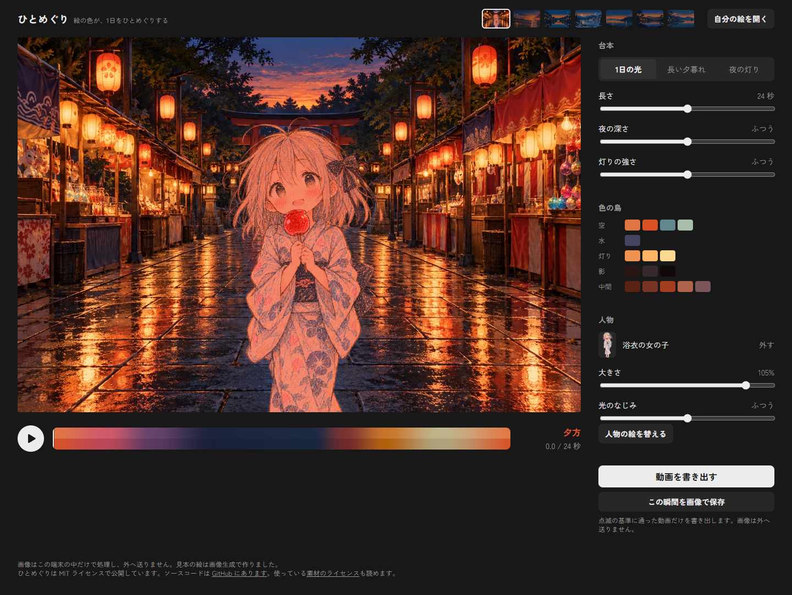

# V02S 人物つきの見本の追加

受け手は、受け入れと合流を判断するメイン。設計 `docs/design/foreground.md` の末尾の基準に対する実装・検査結果と、配布版の画面写真をまとめる。

枝は `surumenDD/v02-samples`、出発点は `603bdcf`。人物を替える入口についてメインへ質問し、回答の設計コミット `0d7b384` を `85e9026` として取り込んだ。docs の独自編集、元の assets の編集、パッケージの追加、main への合流、push は行っていない。

## 受け入れの基準

| 領域               | 結果 | 根拠                                                                                                                                                                                                 |
| ------------------ | ---- | ---------------------------------------------------------------------------------------------------------------------------------------------------------------------------------------------------- |
| 開いたとき         | 合格 | 配布版3ブラウザで、お祭り・浴衣の女の子、x=0.5、y=1.26、大きさ105%、光のなじみ0.8、0秒の静止画。見本は指定の7枚の順。                                                                                |
| 切り替え           | 合格 | 3ブラウザで人物の扱いの4つの決まりを検査。見本を替えると人物と設定を読み直す、外して再選択すると復帰、人物なしの見本／自分の絵では見本の人物を外す、使い手の人物は設定ごと保つ。                     |
| 人物を替える       | 合格 | 見本・使い手の人物のどちらにも「人物の絵を替える」を表示。Tabで到達しEnterで選択でき、置き方となじみを保つ。置き換えた人物は使い手の人物になる。透過なしの画像を選んだ場合は、元の人物と設定を保つ。 |
| 元に戻る・背景     | 合格 | 2枚×3台本×始まり／終わりの12描画で、配ったWebPの復号画素と全画素差0。                                                                                                                                |
| 元に戻る・人物つき | 合格 | 同じ12描画で、CPUのv2の光の式と線形合成に対して全画素の8ビット最大差1。各台本の始まりと終わりの6比較は差0。                                                                                          |
| v2の式             | 合格 | 中間の3時点×なじみ0/0.8/1×3台本×2枚の54比較で、実シェーダーとCPUの式の差1以下。既存の人物の単体検査も合格。                                                                                          |
| 点滅               | 合格 | 2枚×3台本の6本を実際の人物と配置で保存。書き出し前の実描画判定と、保存MP4の全4,560コマを復号したWCAG・ITUの両方に合格。                                                                              |
| 重さ               | 合格 | キャッシュなしの初期読み込みはChrome 2,728,228 bytes、Firefox 2,734,941 bytes、WebKit 2,718,293 bytes。いずれも3,000,000 bytes以下。未選択の本画像・人物は0件。                                      |
| 人物なしの既存5枚  | 合格 | 既存の背景・小さな見本の10ファイルはGitのblobが出発点と一致。従来の固定シェーダーとの5枚×3台本×6時点の90比較で全画素差0。                                                                            |
| 既存の検査         | 合格 | `npm run check`：型、Biome、15ファイル88件のVitest、開発版と配布版Chrome、174依存のライセンス。既存8画像の再現と端点はPSNR Infinity。                                                                |
| 3ブラウザ・axe     | 合格 | 既存の互換性検査は各8状態、新しい見本の検査は各4状態でaxe違反0。操作、PNG/MP4、島と分割、reduced motion、キーボード、コンソール、外部通信を確認。                                                    |
| 60fps・スマホ      | 合格 | 両場面とも1920×1080のRAF中央値16.7ms。390pxの3ブラウザで横はみ出しなし。既存のChromeの実タッチドラッグも合格。                                                                                       |
| 小さな見本         | 合格 | 96×64。配布版と同じ人物と配置、1日の光の0秒を実Rendererで合成してから縮小。保存した可逆WebPの復号画素と再生成した絵の差0。                                                                           |
| 保存名             | 合格 | 既存の保存名の作りを維持。3ブラウザで「ひとめぐり-お祭り-0秒.png」を実保存して確認。MP4は同じ`outputName`を使う。                                                                                    |

数値、Resource Timingの全項目、素材のSHA-256、基準ごとの描画比較、3ブラウザの結果、6本の点滅結果は [V02S-results.json](V02S-results.json)。

## 実装

`src/samples.ts` に人物の画像、名前、位置、大きさ、光のなじみを持てる定義を追加した。お祭りと海辺を先頭に置き、既存の初期選択の処理でお祭りを開く。背景の島の役割は自動推定を使う。

ストアは人物の由来を`sample`／`user`で区別する。背景と見本の人物をまとめて読み、前処理と安全の見積もりが終わってから、1回の更新で新しい場面にする。読み込みの失敗時は前の場面を保ち、遅れて終わった読み込みで新しい場面を上書きしない。取り消した読み込み用のSafetyClientも解放する。これらはストアの6件の単体検査に含む。

メインの追記に従い、人物があるときは出どころにかかわらず「人物の絵を替える」を表示する。使い手が画像を選び直すと、位置・大きさ・光のなじみを保って置き換える。

大きい配置では、人物の元画像の画素境界に表示の画素中心が重なり、GPUの近傍サンプルとCPUの倍精度計算で隣の画素を選ぶ場合があった。お祭りの全画素比較で最大差143として再現した。人物だけを`texelFetch`による整数座標の選択に替え、境界の丸めを元画像の0.001画素でそろえた。修正後は最大差1。光の式、背景のサンプル、人物なしの描画は変えていない。既存の人物の描画検査も再実行して合格した。

`test/showcase-render.mjs`へ`festival`／`seaside`のidを渡すと、サイトと同じ人物と設定を使う。明示した`#foreground=...`はそれを置き換える。次のジョブへ前の人物を引き継がない作りは保った。

## 画像の容量と初期読み込み

Pillow 12.3.0で変換。背景は元の1536×1024を保ち、非可逆WebP・quality=90・method=6。人物は1024×1536、可逆WebP・method=6・exact=trueで、透明な画素を含むRGBAが元PNGと一致する。元素材は読むだけで、既存5枚のWebPは変えていない。

| 配る画像             |     bytes |
| -------------------- | --------: |
| お祭りの背景         |   556,928 |
| 浴衣の女の子         | 1,557,860 |
| 海辺の背景           |   292,900 |
| 海辺の女の子         | 1,420,028 |
| お祭りの96×64        |    12,760 |
| 海辺の96×64          |     9,546 |
| 既存5枚の96×64の合計 |    12,158 |

配布版を`/hitomeguri-color/`で開き、ブラウザごとに新しいcontextを使って測定した。ページ側のリクエストは記録だけにし、HTTPキャッシュを無効化するPlaywrightのrouteは使っていない。ナビゲーションとResource Timingの`transferSize`の合計で、M4と同じく圧縮後の転送とヘッダーの推計を含む。

| 初期に読むもの（bytes） |        Chrome |       Firefox |        WebKit |
| ----------------------- | ------------: | ------------: | ------------: |
| HTML                    |         1,108 |         1,108 |         1,108 |
| JavaScript・Worker      |       113,850 |       113,850 |       113,850 |
| CSS                     |       100,591 |       100,591 |       100,591 |
| お祭りの背景            |       557,228 |       557,228 |       557,228 |
| 浴衣の女の子            |     1,558,460 |     1,558,160 |     1,558,460 |
| 小さな見本7枚           |        36,564 |        36,564 |        36,564 |
| フォント                |       359,132 |       350,492 |       350,492 |
| アイコン                |         1,295 |        16,948 |             0 |
| **合計**                | **2,728,228** | **2,734,941** | **2,718,293** |

人物はデコード用とパネル用でResource Timingに2回現れる環境があるが、2回目はキャッシュを使い、画像本体を二重に転送していない。表はそのヘッダーの分も合算した。未選択の本体を読まないことは、大きい画像のURLが選択中の背景と人物の2種類だけであることでも検査した。フォント・画像を含む外部通信は0件。

## 保存動画と描画時間

動画は960×640、30fps。既定の長さと設定で、アプリの書き出しを使う。flash-checkは白200cd/m²、ブロック8px、`--css-px-per-px 1.6`。最大回数は場所ごとの1秒あたりの値。

| 見本   | 台本       | 秒／コマ | WCAG | ITU  | 最大回数／秒 |
| ------ | ---------- | -------: | ---- | ---- | -----------: |
| お祭り | 1日の光    |  24／720 | 合格 | 合格 |            1 |
| お祭り | 長い夕暮れ |  20／600 | 合格 | 合格 |            1 |
| お祭り | 夜の灯り   |  32／960 | 合格 | 合格 |            1 |
| 海辺   | 1日の光    |  24／720 | 合格 | 合格 |            1 |
| 海辺   | 長い夕暮れ |  20／600 | 合格 | 合格 |            1 |
| 海辺   | 夜の灯り   |  32／960 | 合格 | 合格 |            1 |

1080pはRTX 5070 Ti／ANGLE D3D11で、準備12回、GPUタイマーと1画素の同期読み戻し31回、RAF120区間を測った。

| 見本   | GPU中央値 | 同期込みの壁時計中央値 | RAF中央値 | RAF 95%点／最大 |
| ------ | --------: | ---------------------: | --------: | --------------: |
| お祭り |   0.181ms |                0.400ms |    16.7ms |    16.8／16.9ms |
| 海辺   |   0.345ms |                0.700ms |    16.7ms |    16.8／16.9ms |

低性能GPUでの測定ではない。Windows版WebKit 27.2は既存と同じくH.264のWebCodecsに非対応で、案内の表示と、その後もPNGを保存できることを確認した。macOSの実機Safariでの結果ではない。

## 画面写真

配布版・通常の動きの設定・始まりの0秒。スマホも最初のお祭りを開いた状態。

| ブラウザ             | 開いたとき                         | 海辺                             | 見本の一覧                      | スマホ390px                       |
| -------------------- | ---------------------------------- | -------------------------------- | ------------------------------- | --------------------------------- |
| Chrome 155.0.8059.86 | [お祭り](V02S-chrome-initial.png)  | [海辺](V02S-chrome-seaside.png)  | [7枚](V02S-chrome-samples.png)  | [スマホ](V02S-chrome-mobile.png)  |
| Firefox 158.0        | [お祭り](V02S-firefox-initial.png) | [海辺](V02S-firefox-seaside.png) | [7枚](V02S-firefox-samples.png) | [スマホ](V02S-firefox-mobile.png) |
| WebKit 27.2          | [お祭り](V02S-webkit-initial.png)  | [海辺](V02S-webkit-seaside.png)  | [7枚](V02S-webkit-samples.png)  | [スマホ](V02S-webkit-mobile.png)  |




見た目の受け入れとmainへの採用判断はメインが行う。

## 再検査

`app/`で実行する。READMEのNode・ブラウザ・ffmpeg／ffprobeに加え、素材の再生成には既存のPythonとPillowが必要。新しい依存は追加していない。

```powershell
node test/v02s-assets.mjs
npm run check
npm run test:compat
node test/v02s-render.mjs
node test/v02s-browser.mjs
node test/v02s-flash.mjs
node test/v02-foreground.mjs
node test/v02-touch.mjs
```

生の結果とログは`test/results/v02s/`、6本の動画はその`videos/`。既存の互換性検査は`test/results/m4-browsers/report.json`、人物の既存検査は`test/results/v02/report.json`。これらの媒体とログはGit管理外。過去の報告の画面写真を上書きしないよう、既存の検査の追加写真は`test/results/V02S-*`へ出す。今回採用しなかった検査の写真は`test/results/v02s/compat-captures/`へ元の名前を保って移した。

検査用のサーバーとブラウザは各スクリプトのfinallyで閉じる。コミットはこの枝だけに行い、メインの作業ツリーと既存の配信には触れない。
